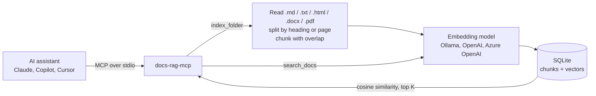

<p align="center">
  
</p>

# docs-rag-mcp

[](https://github.com/Ahmed-Manai/docs-rag-mcp/actions/workflows/ci.yml)
[](LICENSE)


[](https://www.nuget.org/packages/DocsRagMcp)

[](https://glama.ai/mcp/servers/Ahmed-Manai/docs-rag-mcp)

<!-- mcp-name: io.github.Ahmed-Manai/docs-rag-mcp -->

An [MCP](https://modelcontextprotocol.io) server, written in C#, that lets Claude, GitHub Copilot, Cursor and other AI assistants search **your own documents** with retrieval-augmented generation (RAG).

Point it at a folder of Markdown, text, HTML, Word or PDF files. It splits them into passages, turns each passage into an embedding, and stores everything in a local SQLite file. When you ask your assistant a question, it calls `search_docs`, gets back the most relevant passages with their file and section, and answers from them.

- **Runs fully local** with [Ollama](https://ollama.com), or uses OpenAI or Azure OpenAI embeddings
- **One file, no database server**: the index is a single SQLite file
- **Incremental**: re-indexing only embeds files that changed, and drops files you deleted
- **Stays in sync**: indexed folders are watched, so new, edited and deleted files are picked up on their own, even changes made while the server was stopped
- **Cites its sources**: every passage comes with its file path and heading or PDF page
- **Indexed files are MCP resources**: clients can list them and attach a whole document to the conversation
- **Reads HTML too**: saved web pages and generated docs sites are split at their headings, without scripts, styles, menus, headers and footers
- **Reads Word documents**: `.docx` files are split at their Title and Heading 1 to 3 paragraphs, in any language version of Word, with lists and tables kept readable
- **Ignores front matter**: YAML front matter from Jekyll, Hugo, Docusaurus or Obsidian is left out of the index, and its `title` names the text before the first heading
- **Hybrid search**: ranks by meaning and by keywords, so exact terms such as API names and error codes are found too
- **Safe by default for shared machines**: you can limit which folders it may read

## Example

With the [sample handbook](samples/handbook) indexed, asking *"Can I spend a month working from Spain?"* returns:

```text
2 passages for "Can I spend a month working from Spain?":

[1] samples/handbook/remote-work.md > Working from another country (score 0.71)
## Working from another country

You can work from another country for up to 30 days a year. Tell your manager and HR
two weeks in advance, because some countries need paperwork for tax and insurance.

[2] samples/handbook/remote-work.md > Remote work (score 0.57)
...
```

Neither "Spain" nor "month" appears in the document. The search matches on meaning, not keywords.

## How it works



## Quick start (local, with Ollama)

You need the [.NET 10 SDK](https://dotnet.microsoft.com/download) and [Ollama](https://ollama.com/download). Pull the embedding model once:

```bash
ollama pull nomic-embed-text
```

The server is published on [NuGet](https://www.nuget.org/packages/DocsRagMcp) and in the [MCP Registry](https://registry.modelcontextprotocol.io) as `io.github.Ahmed-Manai/docs-rag-mcp`. `dnx`, which comes with .NET 10, downloads and starts it, so there is nothing else to install. Add it to your assistant in one click:

[](https://insiders.vscode.dev/redirect/mcp/install?name=docs-rag&inputs=%5B%7B%22type%22%3A%22promptString%22%2C%22id%22%3A%22docs-folder%22%2C%22description%22%3A%22Folder%20with%20the%20documents%20the%20server%20may%20index%22%7D%5D&config=%7B%22type%22%3A%22stdio%22%2C%22command%22%3A%22dnx%22%2C%22args%22%3A%5B%22DocsRagMcp%22%2C%22--yes%22%5D%2C%22env%22%3A%7B%22DOCSRAG_ALLOWED_PATHS%22%3A%22%24%7Binput%3Adocs-folder%7D%22%7D%7D)
[](https://insiders.vscode.dev/redirect/mcp/install?name=docs-rag&inputs=%5B%7B%22type%22%3A%22promptString%22%2C%22id%22%3A%22docs-folder%22%2C%22description%22%3A%22Folder%20with%20the%20documents%20the%20server%20may%20index%22%7D%5D&config=%7B%22type%22%3A%22stdio%22%2C%22command%22%3A%22dnx%22%2C%22args%22%3A%5B%22DocsRagMcp%22%2C%22--yes%22%5D%2C%22env%22%3A%7B%22DOCSRAG_ALLOWED_PATHS%22%3A%22%24%7Binput%3Adocs-folder%7D%22%7D%7D&quality=insiders)
[](https://cursor.com/install-mcp?name=docs-rag&config=eyJjb21tYW5kIjoiZG54IiwiYXJncyI6WyJEb2NzUmFnTWNwIiwiLS15ZXMiXX0%3D)

VS Code asks which folder the server may read. The Cursor button lets it read any folder: to limit it, add `DOCSRAG_ALLOWED_PATHS` to its entry in `~/.cursor/mcp.json`, as shown below.

Or add it by hand:

<details open>
<summary><b>Claude Desktop</b></summary>

In `claude_desktop_config.json` (Settings > Developer > Edit Config):

```json
{
  "mcpServers": {
    "docs-rag": {
      "command": "dnx",
      "args": ["DocsRagMcp", "--yes"],
      "env": {
        "DOCSRAG_ALLOWED_PATHS": "/path/to/your/notes"
      }
    }
  }
}
```

</details>

<details>
<summary><b>VS Code (GitHub Copilot)</b></summary>

In `.vscode/mcp.json`:

```json
{
  "servers": {
    "docs-rag": {
      "type": "stdio",
      "command": "dnx",
      "args": ["DocsRagMcp", "--yes"],
      "env": {
        "DOCSRAG_ALLOWED_PATHS": "${workspaceFolder}"
      }
    }
  }
}
```

</details>

<details>
<summary><b>Cursor</b></summary>

In `~/.cursor/mcp.json`, use the same `mcpServers` block as for Claude Desktop.

</details>

<details>
<summary><b>Claude Code</b></summary>

```bash
claude mcp add docs-rag -e DOCSRAG_ALLOWED_PATHS=/path/to/your/notes -- dnx DocsRagMcp --yes
```

</details>

<details>
<summary><b>From source</b></summary>

```bash
git clone https://github.com/Ahmed-Manai/docs-rag-mcp.git
cd docs-rag-mcp
dotnet build -c Release
```

Then use `"command": "dotnet"` with `"args": ["run", "--no-build", "-c", "Release", "--project", "/path/to/docs-rag-mcp/src/DocsRagMcp"]`.

</details>

Now ask your assistant: *"Index my notes in /path/to/your/notes"*, then ask questions about them.

### Try it on the sample handbook

No documents at hand? The repository comes with a short employee handbook:

```bash
git clone https://github.com/Ahmed-Manai/docs-rag-mcp.git
```

Allow `docs-rag-mcp/samples/handbook` in `DOCSRAG_ALLOWED_PATHS`, then ask your assistant:

1. *"Index the folder /path/to/docs-rag-mcp/samples/handbook"*
2. *"Can I spend a month working from Spain?"*

It answers from the "Working from another country" section of `remote-work.md`, as in the [example](#example) above.

## Tools

| Tool | What it does |
|------|--------------|
| `index_folder` | Indexes the Markdown, text, HTML, Word and PDF files in a folder and its subfolders. Unchanged files are skipped and deleted files are removed. The folder is then watched and kept in sync. |
| `search_docs` | Returns the passages closest in meaning to a question, with file, section and score. Optional `topK` (1-20) and `folder`, which limits the search to part of the index (see below). |
| `list_sources` | Shows where the index is, its size and the embedding model that built it, then lists the indexed files with their number of chunks and when they were indexed, and the watched folders. |
| `remove_from_index` | Removes a file, or every file in a folder, from the index, and stops watching the folder. Files on disk are never touched. |

`search_docs` and `list_sources` are marked read-only and `remove_from_index` destructive, so clients can decide when to ask you for confirmation.

### Searching part of the index

`folder` accepts any of these, and only files inside it are scored, both by meaning and by keywords:

- an absolute path of a folder or a single file, such as `/home/me/notes/api`
- a resource URI, such as `file:///home/me/notes/api/auth.md`
- a path relative to the indexed folders, such as `api/v2`: it matches that subfolder in every indexed folder that has one

If no indexed file is inside it, `search_docs` says so instead of returning unrelated passages.

## Resources

Every indexed file is also an [MCP resource](https://modelcontextprotocol.io/specification/2025-11-25/server/resources), so clients that support resources (for example Claude Desktop and VS Code) can list the files and attach a whole document to the conversation, not only the passages `search_docs` finds.

| Field | Value |
|---|---|
| URI | The file's `file://` URI, for example `file:///home/me/notes/handbook/travel.md` or `file:///C:/Users/me/notes/handbook/travel.md` |
| Name | The indexed folder and the path inside it, for example `handbook/travel.md` |
| Content | Markdown and text files as they are on disk. HTML, Word and PDF files as the text extracted for the index, with PDF pages marked `[page 2]` |
| MIME type | `text/markdown` for Markdown files, `text/plain` for everything else |

The list follows the index: when files are indexed, changed or removed, the server sends `notifications/resources/list_changed`.

Only files that are in the index can be read. A file that is not indexed, was deleted, has become a symbolic link (or sits in a folder that has), or is no longer inside `DOCSRAG_ALLOWED_PATHS` is refused, even if its URI is valid.

## Configuration

Settings come from environment variables (or the matching command-line switch, such as `--provider`).

| Variable | Default | Description |
|----------|---------|-------------|
| `DOCSRAG_PROVIDER` | `ollama` | `ollama`, `openai` or `azure` |
| `DOCSRAG_MODEL` | `nomic-embed-text` (Ollama), `text-embedding-3-small` (OpenAI) | Embedding model, or the **deployment name** for Azure OpenAI |
| `DOCSRAG_ENDPOINT` | `http://localhost:11434` (Ollama) | Required for Azure OpenAI. For OpenAI, set it to use any OpenAI-compatible API |
| `DOCSRAG_API_KEY` | | OpenAI or Azure OpenAI key. Read from the environment only, never from the command line |
| `DOCSRAG_ALLOWED_PATHS` | any folder | Folders the server may index, separated by `;` on Windows and `:` on macOS and Linux |
| `DOCSRAG_DATABASE` | `~/.docs-rag-mcp/index.db` | Where the index is stored |
| `DOCSRAG_CHUNK_SIZE` | `1200` | Maximum characters per chunk |
| `DOCSRAG_CHUNK_OVERLAP` | `200` | Characters repeated between consecutive chunks |
| `DOCSRAG_SEARCH_MODE` | `hybrid` | `hybrid` combines keyword and vector ranking; `vector` uses vector similarity only |
| `DOCSRAG_WATCH` | `true` | Watch indexed folders and index changes automatically. Set to `false` to index only when `index_folder` is called |

### OpenAI

```json
"env": {
  "DOCSRAG_PROVIDER": "openai",
  "DOCSRAG_API_KEY": "sk-..."
}
```

### Azure OpenAI

```json
"env": {
  "DOCSRAG_PROVIDER": "azure",
  "DOCSRAG_ENDPOINT": "https://my-resource.openai.azure.com/",
  "DOCSRAG_MODEL": "my-embedding-deployment"
}
```

Without `DOCSRAG_API_KEY`, the server signs in with Microsoft Entra ID through `DefaultAzureCredential` (`az login`, Visual Studio, managed identity...). Your account needs the **Cognitive Services OpenAI User** role on the resource.

### LM Studio, vLLM and other OpenAI-compatible servers

```json
"env": {
  "DOCSRAG_PROVIDER": "openai",
  "DOCSRAG_ENDPOINT": "http://localhost:1234/v1",
  "DOCSRAG_MODEL": "text-embedding-nomic-embed-text-v1.5"
}
```

## Privacy and security

- With Ollama, documents and questions never leave your machine.
- The server only **reads** your files. The only file it writes is the index.
- Resources only serve files that are in the index and still inside `DOCSRAG_ALLOWED_PATHS`. A URI can't be used to read any other file.
- Set `DOCSRAG_ALLOWED_PATHS` so an assistant can't index folders you didn't intend, such as your home folder. Paths are resolved before they are checked, so `docs/../secrets` doesn't get around it.
- Hidden folders (`.git`, `.ssh`, ...), symbolic links and `node_modules`, `bin` and `obj` folders are skipped.
- An index remembers which embedding model built it. Searching it with a different model is refused instead of silently returning wrong results.

## Design notes

The article [I built a local RAG server for Claude and Copilot in C#. Here is what I learned about search.](https://dev.to/ahmed_manai/i-built-a-local-rag-server-for-claude-and-copilot-in-c-here-is-what-i-learned-about-search-2h3) walks through these choices and what they changed in the search results.

- **Chunking follows the document's structure.** Markdown, HTML and Word documents are split at headings and PDFs by page before being cut into chunks, so every passage knows where it came from. Chunks break at paragraph boundaries when they can, and overlap a little so an idea that spans two chunks can still be found.
- **Each chunk is embedded with its context.** The text sent to the embedding model starts with the file name and heading (for example `travel-and-expenses.md > Hotels`). A short passage like "220 EUR in Paris" then still matches a question about hotel budgets.
- **Brute-force cosine search over SQLite.** Vectors are stored as blobs and compared with `TensorPrimitives.CosineSimilarity`, which uses SIMD. For personal and team document sets (up to tens of thousands of chunks) this stays fast and needs no native vector extension. A vector index is on the roadmap for larger sets.
- **Hybrid ranking.** Embeddings are good at meaning but can miss exact terms: in testing, "require a login" matched a page about *logging*. Each chunk is therefore also indexed with SQLite's built-in FTS5 full-text search (porter stemming, headings weighted twice as much as body text). A search scores the candidates both ways, scales both scores to 0..1 and blends them 90% meaning, 10% keywords. Keywords settle close calls without outvoting a clearly better meaning match. Reciprocal rank fusion was tried first, but it let any passage that shared a word with the question beat the best meaning match, and it pushed correct answers down on plain-language questions. The score shown next to each passage is still the cosine similarity.
- **Content hashes make re-indexing cheap.** Each file's SHA-256 is stored, so running `index_folder` again only calls the embedding model for files that changed.
- **Watching reuses the same sync.** Indexed folders are stored in the index and watched with `FileSystemWatcher`. Events only say *that* something changed: they arrive in bursts, can be lost when too many come at once, and differ between Windows, macOS and Linux. So instead of handling events one by one, the watcher waits until the folder has been quiet for 2 seconds and then runs the normal sync, which uses the content hashes to re-embed only what changed. When the server starts, it runs that sync once per folder to catch up on changes made while it was stopped. Changes in hidden and skipped folders, and to the index file itself, are ignored.
- **Provider-agnostic.** The server depends only on `IEmbeddingGenerator` from [Microsoft.Extensions.AI](https://learn.microsoft.com/dotnet/ai/microsoft-extensions-ai). Supporting another provider means changing one factory class.

## Development

```bash
dotnet build
dotnet test
```

The tests use a deterministic fake embedding model, so they need no network. A few of them start the real server process and talk to it over MCP, the way an assistant does.

To check everything against a real model (Ollama by default):

```bash
dotnet run samples/smoke.cs -- "How much can I spend on a hotel in Paris?"
```

### Measuring search quality

`samples/eval/` holds two sets of questions with known answers. The evaluation indexes the documents once and asks every question in both search modes:

- `handbook.json`: 14 employee questions about the sample handbook, each with the section that answers it. Most use different words from the handbook.
- `mcp-csharp-sdk-docs.json`: 22 developer questions about the [MCP C# SDK](https://github.com/modelcontextprotocol/csharp-sdk) documentation (30 pages, 556 chunks), each with the page that answers it.

```bash
dotnet run samples/eval/eval.cs -- samples/eval/handbook.json .

git clone https://github.com/modelcontextprotocol/csharp-sdk /tmp/csharp-sdk
git -C /tmp/csharp-sdk checkout 64cfd66b147553d8cf953f9e2a374aae96014968
dotnet run samples/eval/eval.cs -- samples/eval/mcp-csharp-sdk-docs.json /tmp/csharp-sdk --details
```

Results with Ollama and `nomic-embed-text`:

| Search mode | Handbook: right section first | SDK docs: right page first | SDK docs: right page in the top 3 | SDK docs: mean reciprocal rank |
|---|---|---|---|---|
| `vector` (0.1.0) | 14 of 14 | 11 of 22 | 15 of 22 | 0.61 |
| `hybrid` (0.2.0) | 14 of 14 | 12 of 22 | 17 of 22 | 0.66 |

Keyword matching helps most when the question names the feature, such as cancellation, elicitation or completions. It can't help when the question shares no distinctive word with the answer. Both sets are small, so treat these numbers as a direction, not a benchmark.

```text
src/DocsRagMcp/
  Program.cs                  host, dependency injection, MCP server setup
  DocsRagOptions.cs           settings and validation
  Tools/DocsTools.cs          the four MCP tools
  Resources/DocsResources.cs  indexed files as MCP resources
  Indexing/DocumentIndexer.cs folder sync: hash, read, chunk, embed, store
  Indexing/PathGuard.cs       allowed-folder checks
  Ingestion/DocumentReader*.cs Markdown, text, HTML, Word and PDF reading
  Ingestion/TextChunker.cs    chunking with overlap
  Storage/ChunkStore.cs       SQLite storage, vector and keyword search, rank fusion
  Storage/KeywordQuery.cs     turns a question into a safe FTS5 query
  Embeddings/                 Ollama, OpenAI and Azure OpenAI clients
tests/DocsRagMcp.Tests/       unit and end-to-end tests
samples/                      sample documents, the smoke test and the search evaluation
```

## Roadmap

- Reranking the top results with a cross-encoder model
- A vector index for very large document sets

Contributions are welcome! See [CONTRIBUTING.md](CONTRIBUTING.md) to get started, pick a [good first issue](https://github.com/Ahmed-Manai/docs-rag-mcp/issues?q=is%3Aissue+is%3Aopen+label%3A%22good+first+issue%22), or share an idea in [Discussions](https://github.com/Ahmed-Manai/docs-rag-mcp/discussions).

## License

[MIT](LICENSE)
