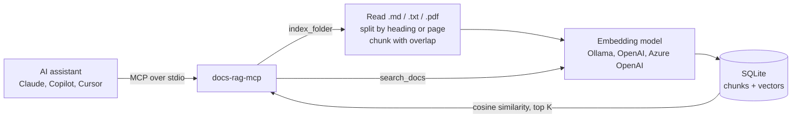

# docs-rag-mcp

[](https://github.com/Ahmed-Manai/docs-rag-mcp/actions/workflows/ci.yml)
[](LICENSE)


[](https://www.nuget.org/packages/DocsRagMcp)

[](https://glama.ai/mcp/servers/Ahmed-Manai/docs-rag-mcp)

<!-- mcp-name: io.github.Ahmed-Manai/docs-rag-mcp -->

An [MCP](https://modelcontextprotocol.io) server, written in C#, that lets Claude, GitHub Copilot, Cursor and other AI assistants search **your own documents** with retrieval-augmented generation (RAG).

Point it at a folder of Markdown, text or PDF files. It splits them into passages, turns each passage into an embedding, and stores everything in a local SQLite file. When you ask your assistant a question, it calls `search_docs`, gets back the most relevant passages with their file and section, and answers from them.

- **Runs fully local** with [Ollama](https://ollama.com), or uses OpenAI or Azure OpenAI embeddings
- **One file, no database server**: the index is a single SQLite file
- **Incremental**: re-indexing only embeds files that changed, and drops files you deleted
- **Cites its sources**: every passage comes with its file path and heading or PDF page
- **Safe by default for shared machines**: you can limit which folders it may read

## Example

With the [sample handbook](samples/handbook) indexed, asking *"Can I spend a month working from Spain?"* returns:

```text
2 passages for "Can I spend a month working from Spain?":

[1] samples/handbook/remote-work.md > Working from another country (score 0.71)
## Working from another country

You can work from another country for up to 30 days a year. Tell your manager and HR
two weeks in advance, because some countries need paperwork for tax and insurance.

[2] samples/handbook/remote-work.md > Remote work (score 0.57)
...
```

Neither "Spain" nor "month" appears in the document. The search matches on meaning, not keywords.

## How it works



## Quick start (local, with Ollama)

You need the [.NET 10 SDK](https://dotnet.microsoft.com/download) and [Ollama](https://ollama.com/download). Pull the embedding model once:

```bash
ollama pull nomic-embed-text
```

The server is published on [NuGet](https://www.nuget.org/packages/DocsRagMcp) and in the [MCP Registry](https://registry.modelcontextprotocol.io) as `io.github.Ahmed-Manai/docs-rag-mcp`. `dnx`, which comes with .NET 10, downloads and starts it, so there is nothing else to install. Add it to your assistant:

<details open>
<summary><b>Claude Desktop</b></summary>

In `claude_desktop_config.json` (Settings > Developer > Edit Config):

```json
{
  "mcpServers": {
    "docs-rag": {
      "command": "dnx",
      "args": ["DocsRagMcp", "--yes"],
      "env": {
        "DOCSRAG_ALLOWED_PATHS": "/path/to/your/notes"
      }
    }
  }
}
```

</details>

<details>
<summary><b>VS Code (GitHub Copilot)</b></summary>

In `.vscode/mcp.json`:

```json
{
  "servers": {
    "docs-rag": {
      "type": "stdio",
      "command": "dnx",
      "args": ["DocsRagMcp", "--yes"],
      "env": {
        "DOCSRAG_ALLOWED_PATHS": "${workspaceFolder}"
      }
    }
  }
}
```

</details>

<details>
<summary><b>Cursor</b></summary>

In `~/.cursor/mcp.json`, use the same `mcpServers` block as for Claude Desktop.

</details>

<details>
<summary><b>Claude Code</b></summary>

```bash
claude mcp add docs-rag -e DOCSRAG_ALLOWED_PATHS=/path/to/your/notes -- dnx DocsRagMcp --yes
```

</details>

<details>
<summary><b>From source</b></summary>

```bash
git clone https://github.com/Ahmed-Manai/docs-rag-mcp.git
cd docs-rag-mcp
dotnet build -c Release
```

Then use `"command": "dotnet"` with `"args": ["run", "--no-build", "-c", "Release", "--project", "/path/to/docs-rag-mcp/src/DocsRagMcp"]`.

</details>

Now ask your assistant: *"Index my notes in /path/to/your/notes"*, then ask questions about them.

## Tools

| Tool | What it does |
|------|--------------|
| `index_folder` | Indexes the Markdown, text and PDF files in a folder and its subfolders. Unchanged files are skipped and deleted files are removed. |
| `search_docs` | Returns the passages closest in meaning to a question, with file, section and score. Optional `topK` (1-20) and `folder` filter. |
| `list_sources` | Lists the indexed files with their number of chunks and when they were indexed. |
| `remove_from_index` | Removes a file, or every file in a folder, from the index. Files on disk are never touched. |

`search_docs` and `list_sources` are marked read-only and `remove_from_index` destructive, so clients can decide when to ask you for confirmation.

## Configuration

Settings come from environment variables (or the matching command-line switch, such as `--provider`).

| Variable | Default | Description |
|----------|---------|-------------|
| `DOCSRAG_PROVIDER` | `ollama` | `ollama`, `openai` or `azure` |
| `DOCSRAG_MODEL` | `nomic-embed-text` (Ollama), `text-embedding-3-small` (OpenAI) | Embedding model, or the **deployment name** for Azure OpenAI |
| `DOCSRAG_ENDPOINT` | `http://localhost:11434` (Ollama) | Required for Azure OpenAI. For OpenAI, set it to use any OpenAI-compatible API |
| `DOCSRAG_API_KEY` | | OpenAI or Azure OpenAI key. Read from the environment only, never from the command line |
| `DOCSRAG_ALLOWED_PATHS` | any folder | Folders the server may index, separated by `;` on Windows and `:` on macOS and Linux |
| `DOCSRAG_DATABASE` | `~/.docs-rag-mcp/index.db` | Where the index is stored |
| `DOCSRAG_CHUNK_SIZE` | `1200` | Maximum characters per chunk |
| `DOCSRAG_CHUNK_OVERLAP` | `200` | Characters repeated between consecutive chunks |

### OpenAI

```json
"env": {
  "DOCSRAG_PROVIDER": "openai",
  "DOCSRAG_API_KEY": "sk-..."
}
```

### Azure OpenAI

```json
"env": {
  "DOCSRAG_PROVIDER": "azure",
  "DOCSRAG_ENDPOINT": "https://my-resource.openai.azure.com/",
  "DOCSRAG_MODEL": "my-embedding-deployment"
}
```

Without `DOCSRAG_API_KEY`, the server signs in with Microsoft Entra ID through `DefaultAzureCredential` (`az login`, Visual Studio, managed identity...). Your account needs the **Cognitive Services OpenAI User** role on the resource.

### LM Studio, vLLM and other OpenAI-compatible servers

```json
"env": {
  "DOCSRAG_PROVIDER": "openai",
  "DOCSRAG_ENDPOINT": "http://localhost:1234/v1",
  "DOCSRAG_MODEL": "text-embedding-nomic-embed-text-v1.5"
}
```

## Privacy and security

- With Ollama, documents and questions never leave your machine.
- The server only **reads** your files. The only file it writes is the index.
- Set `DOCSRAG_ALLOWED_PATHS` so an assistant can't index folders you didn't intend, such as your home folder. Paths are resolved before they are checked, so `docs/../secrets` doesn't get around it.
- Hidden folders (`.git`, `.ssh`, ...), symbolic links and `node_modules`, `bin` and `obj` folders are skipped.
- An index remembers which embedding model built it. Searching it with a different model is refused instead of silently returning wrong results.

## Design notes

- **Chunking follows the document's structure.** Markdown is split at headings and PDFs by page before being cut into chunks, so every passage knows where it came from. Chunks break at paragraph boundaries when they can, and overlap a little so an idea that spans two chunks can still be found.
- **Each chunk is embedded with its context.** The text sent to the embedding model starts with the file name and heading (for example `travel-and-expenses.md > Hotels`). A short passage like "220 EUR in Paris" then still matches a question about hotel budgets.
- **Brute-force cosine search over SQLite.** Vectors are stored as blobs and compared with `TensorPrimitives.CosineSimilarity`, which uses SIMD. For personal and team document sets (up to tens of thousands of chunks) this stays fast and needs no native vector extension. A vector index is on the roadmap for larger sets.
- **Content hashes make re-indexing cheap.** Each file's SHA-256 is stored, so running `index_folder` again only calls the embedding model for files that changed.
- **Provider-agnostic.** The server depends only on `IEmbeddingGenerator` from [Microsoft.Extensions.AI](https://learn.microsoft.com/dotnet/ai/microsoft-extensions-ai). Supporting another provider means changing one factory class.

## Development

```bash
dotnet build
dotnet test
```

The tests use a deterministic fake embedding model, so they need no network. Two of them start the real server process and talk to it over MCP, the way an assistant does.

To check everything against a real model (Ollama by default):

```bash
dotnet run samples/smoke.cs -- "How much can I spend on a hotel in Paris?"
```

```text
src/DocsRagMcp/
  Program.cs                  host, dependency injection, MCP server setup
  DocsRagOptions.cs           settings and validation
  Tools/DocsTools.cs          the four MCP tools
  Indexing/DocumentIndexer.cs folder sync: hash, read, chunk, embed, store
  Indexing/PathGuard.cs       allowed-folder checks
  Ingestion/DocumentReader.cs Markdown, text and PDF reading
  Ingestion/TextChunker.cs    chunking with overlap
  Storage/ChunkStore.cs       SQLite storage and vector search
  Embeddings/                 Ollama, OpenAI and Azure OpenAI clients
tests/DocsRagMcp.Tests/       unit and end-to-end tests
samples/                      sample documents and the smoke test
```

## Roadmap

- Word (`.docx`) and HTML files
- Hybrid search that combines keyword (SQLite FTS5) and vector scores
- A vector index for very large document sets
- Exposing indexed files as MCP resources

Contributions are welcome. Open an issue to discuss an idea first.

## License

[MIT](LICENSE)
